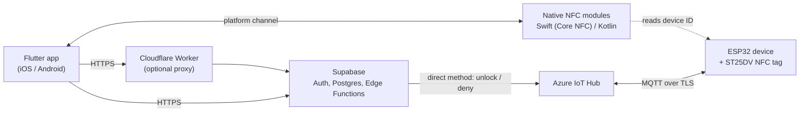

# Access Control

*Návrh a implementácia cross-platformovej mobilnej aplikácie pre kontrolu prístupu*
(Design and Implementation of a Cross-Platform Mobile Application for Access Control)

This is the code for my bachelor's thesis at the Faculty of Mathematics and Physics, Charles University (Prague, 2026). I built a cross-platform access control system. Users unlock doors by tapping their phone on an NFC tag, and administrators manage companies, areas, buildings, devices and access rights in the same mobile app.

The full thesis (in Slovak) is in [thesis/thesis.pdf](thesis/thesis.pdf).

## Architecture

**Mobile app** (`mobile_app/`). Flutter with Riverpod for state management and go_router for navigation. It has `dev` and `prod` flavors and is localized in English, Czech and Slovak. Sessions are kept in secure storage. NFC is implemented natively and exposed to Dart through the `nfc_device_manager` method channel: `NfcFlutterPlugin.swift` uses Core NFC on iOS, and `MainActivity.kt` uses foreground dispatch with `Ndef` on Android.

**Unlock flow.**
1. The ESP32 writes its device ID as an NDEF text record to an ST25DV64KC dynamic NFC tag at boot.
2. The app reads that ID over NFC and calls the `unlock-device` Edge Function.
3. The function verifies the user's JWT and checks permissions with the `can_unlock_device` database function. A user may unlock a device if one of their access keys contains it and the key's validity period covers the current time.
4. The function calls an `unlock` or `deny` direct method on the device through the Azure IoT Hub REST API. It signs the request with a short-lived SAS token.
5. The device acknowledges over MQTT and shows the result on an RGB LED. The app shows success, access denied, device unreachable or no connection.

**Backend** (`supabase/`). Supabase provides authentication, a Postgres database and Deno Edge Functions. The data model is a hierarchy of companies, areas, buildings and devices. Access keys group devices and are assigned to accounts with a validity period. Accounts have one of three roles: owner, manager or user.

| Edge Function | Purpose |
| --- | --- |
| `unlock-device` | Permission check and unlock/deny command to the device |
| `create-iot-device` | Creates a device in the database and registers it in Azure IoT Hub |
| `bulk-create-iot-devices` | Creates many devices at once and rolls back the ones that fail to register in IoT Hub |
| `create-new-account` | Lets an owner create a user account in their company |

**Firmware** (`esp32_IoT/`). An Arduino sketch for the ESP32. It connects to Wi-Fi, then to Azure IoT Hub over MQTT (port 8883) with a SAS token, and listens for direct methods. The prototype signals the result with the LED and does not drive a physical lock.

**Cloudflare Worker** (`cloudflare_worker/`). A small reverse proxy that forwards requests to the Supabase project. I used it on IPv4-only networks, where the phone could not reach Supabase directly. The app uses it when `USE_CLOUDFLARE` is `true`.

## Repository layout

- `mobile_app/`: Flutter app, including the native iOS (Swift) and Android (Kotlin) NFC code
- `supabase/`: Edge Functions (`functions/`) and a schema dump of the database (`supabase_dump.sql`)
- `esp32_IoT/`: ESP32 firmware (Arduino)
- `cloudflare_worker/`: Cloudflare Worker proxy for Supabase
- `thesis/`: the thesis PDF

## Running it

The repository does not contain any credentials, so you need your own Supabase project, Azure IoT Hub and hardware.

- **Database:** create the schema from `supabase/supabase_dump.sql`.
- **Edge Functions:** deploy each file in `supabase/functions/` as a function with the same name. Set `AZURE_CONNECTION_STRING` (an IoT Hub shared access policy connection string) as a function secret. Supabase provides `SUPABASE_URL`, `SUPABASE_ANON_KEY` and `SUPABASE_SERVICE_ROLE_KEY` automatically.
- **App:** copy `mobile_app/.env.example` to `mobile_app/.env` and set `SUPABASE_URL`, `SUPABASE_ANON`, `USE_CLOUDFLARE` and, if you use the worker, `CLOUDFLARE_WORKER_URL`. The optional `DEMO_*` values fill the demo accounts section on the login screen of the `dev` flavor. Run it with `flutter run --flavor dev -t lib/main_dev.dart`, or use the `prod` flavor and `lib/main_prod.dart`.
- **iOS:** the flavor xcconfig files in `mobile_app/ios/Flutter/` only set display names and the asset prefix. To run on a device, set your own signing team and bundle identifiers in Xcode. The team must be allowed to use the NFC Tag Reading capability.
- **ESP32:** copy `esp32_IoT/secrets.h.example` to `esp32_IoT/secrets.h`. Fill in the Wi-Fi credentials, the IoT Hub hostname, the device ID (the device's UUID from the database) and a device SAS token. The sketch needs the PubSubClient, Adafruit NeoPixel and SparkFun ST25DV64KC libraries.
- **Cloudflare Worker:** replace `supabase_url_placeholder` in `worker.js` with your Supabase URL.

## Status

This is a working prototype built for the thesis. It is not production software, and some parts are intentionally simplified:

- The row level security policies give every authenticated user full access to all tables. A real deployment would need per-company and per-role policies.
- The ESP32 does not verify the IoT Hub TLS certificate.
- The `dev` flavor has a demo accounts section on the login screen for testing. The demo accounts share one development password, which is read from the local `.env` file and is not in the repository. Demo accounts and that password must not be used in any real deployment.
- Accounts created in the app get a random password. The app has no password reset screen, so new users need a password reset email or an administrator to set their password.
